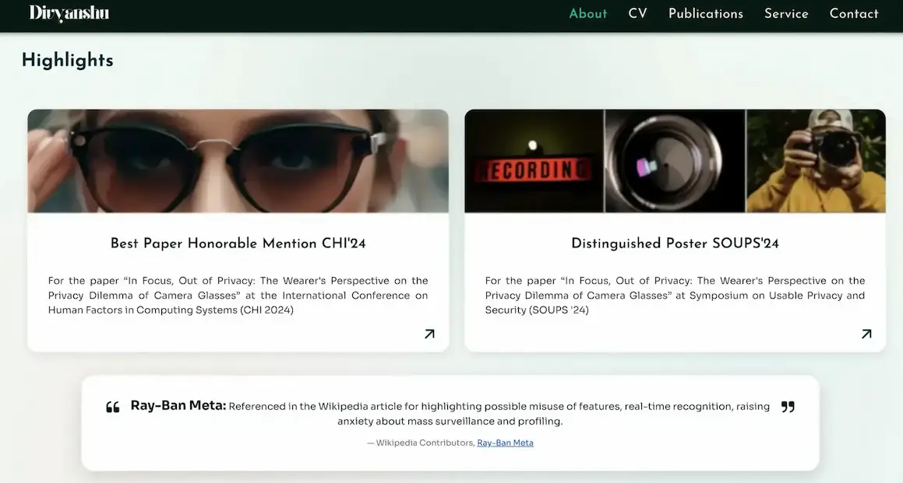
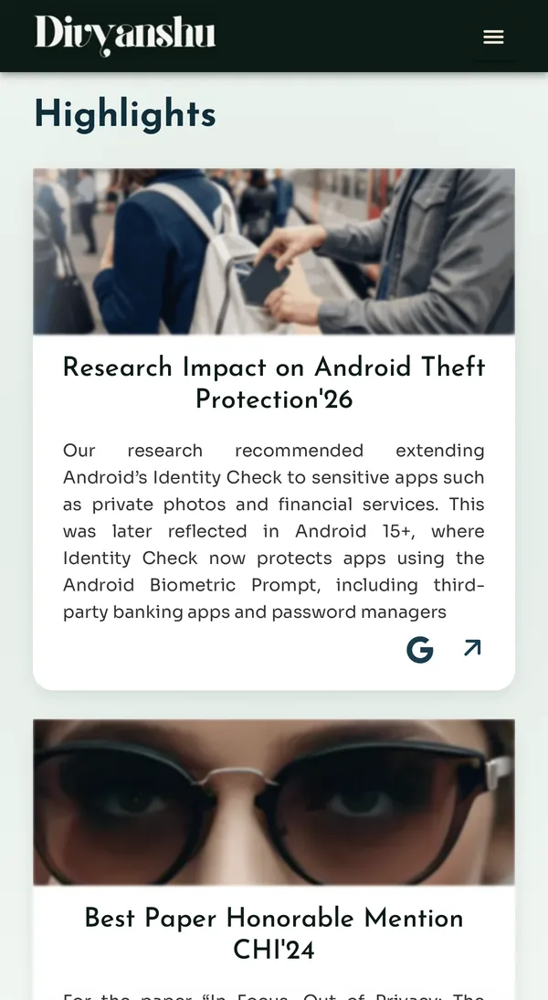
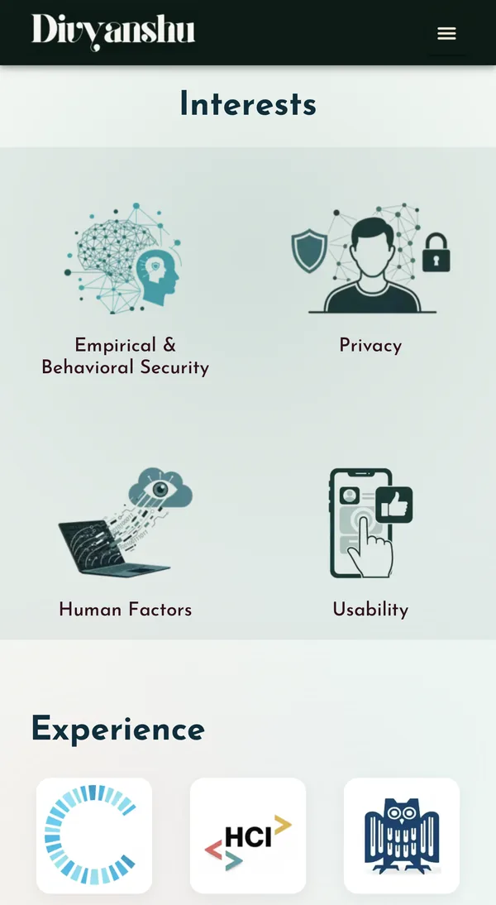
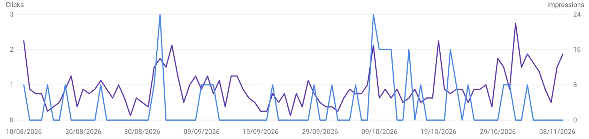

# Academic Portfolio Website
 
**A production research portfolio for a security and privacy researcher at CISPA. Angular 20 and Ionic 8, prerendered to static HTML, served from Firebase Hosting behind Cloudflare.**
 
**Live site:** [divyanshubhardwaj.com](https://divyanshubhardwaj.com) &nbsp;|&nbsp; **Built by:** [Chandrika Mohan](https://chandrikamohan.com), Senior Full Stack Developer
 


 
---
 
## Results
 
Live Google PageSpeed Insights, mobile:
 
| Performance | Accessibility | Best Practices | SEO |
|:-:|:-:|:-:|:-:|
| **87 to 98** | **100** | **100** | **100** |
 

----
 
## Screenshots
 
### Desktop
 

### Mobile
 
The same pages on a phone, with the Ionic side menu, stacked cards and touch-sized controls.
 
<p>
  
  &nbsp;
  
  &nbsp;
  
</p>
---
 
## Architecture at a glance
 
```
Typed content constants (papers, CV, press, service)
        |
        v
Angular 20 standalone app  ->  lazy routes, signals, @defer blocks
        |
        v
Production build (size budgets enforced)
        |
        v
Puppeteer prerender  ->  one static HTML file per route + spa.html fallback
        |
        v
Firebase Hosting (clean URLs, security headers, cache rules)
        |
        v
Cloudflare CDN  ->  browsers, search engines, AI crawlers
```
 
---
 
## Architectural decisions
 
Each decision below lists what was chosen and why.
 
### 1. Standalone components, no NgModules
The app bootstraps with `bootstrapApplication` and provider functions (`provideRouter`, `provideIonicAngular`). Every page and component is standalone and imports only what it uses, including individual Ionic components from `@ionic/angular/standalone`.
**Why:** Smaller bundles through better tree shaking, no shared module bloat, and each file declares its own dependencies.
 
### 2. Ionic for the UI shell, Angular for everything else
Ionic provides the app shell, side menu, router outlet and Material Design mode. Icons are registered once at bootstrap with `addIcons`, so only the icons actually used are shipped.
**Why:** A native feeling mobile experience (menu, gestures, ripple) out of the box, while keeping content pages plain Angular templates.
 
### 3. Route level code splitting
Every route uses `loadComponent`, so each page is its own chunk. The home page is the only eager path.
**Why:** The first visit downloads only the landing page. Visitors coming from Google straight to a paper page never download the CV or press code.
 
### 4. Route guards against unknown content
Paper routes (`publications/:slug`) use a `canMatch` function checked against a small typed slug list. Unknown slugs fall through to a `noindex` 404 page.
**Why:** No soft 404s, no empty pages for mistyped URLs, and the full paper text is not needed to decide whether a route exists. The slug list lives in its own tiny file so the paper content stays inside the lazy paper chunk instead of the initial bundle.
 
### 5. Typed content layer instead of a CMS
All content (publications, paper details, CV, press, service, interests, navigation) lives in typed TypeScript constants with interfaces such as `PaperDetail`. Templates render from data.
**Why:** No backend, no database, no runtime API calls and no CMS cost. The compiler catches missing fields, content changes go through pull requests with full history, and the data is available at build time for prerendering.
 
### 6. Signals for state
UI state such as menu open state, active navigation fragment and footer visibility uses Angular signals, exposed read only where shared (`asReadonly()`). Shared state lives in small `providedIn: 'root'` services.
**Why:** Fine grained reactivity without a state library. The app is small enough that a store like NgRx would be pure overhead.
 
### 7. OnPush change detection and modern control flow
Components use `ChangeDetectionStrategy.OnPush` and the built in `@if` / `@for` control flow with `track` expressions.
**Why:** Fewer change detection cycles and stable DOM updates for lists.
 
### 8. Deferred loading inside pages
Below the fold sections (experience, highlights, contact call to action, footers) are wrapped in `@defer (on idle)` or `@defer (on viewport)`.
**Why:** The browser paints the visible content first. Secondary sections and their code load only when the page is idle or the user scrolls to them, which keeps Largest Contentful Paint and Total Blocking Time low.
 
### 9. Lazy third party SDKs
The EmailJS SDK is loaded with a dynamic `import()` only when the contact form is submitted.
**Why:** Third party code never blocks the first render, and visitors who never contact anyone never download it.
 
### 10. Build time prerendering instead of SSR
A custom Puppeteer script renders every route after the production build and writes static HTML, including the page's meta tags, structured data and per route `modulepreload` hints. An `spa.html` fallback (marked `noindex`) handles any other URL, and a skeleton overlay hides the Ionic shell until web components hydrate.
**Why:** The content changes only when the site is deployed, so a server rendering on every request adds cost and moving parts for no benefit. Static files give crawlers full HTML, give users a fast first paint, and keep hosting free on Firebase.
 
### 11. Page owned head tags
Each page sets its own title, description, canonical URL, structured data and citation tags through small services (`SeoService`, `CanonicalService`, `StructuredDataService`). Tags are tagged with the owning page and only that page removes them on navigation.
**Why:** In a single page app, head tags otherwise leak between routes. Scoping them per page fixed a real bug where navigating from one paper to another dropped the second paper's tags.
 
### 12. Hosting and edge configuration as code
`firebase.json` defines clean URLs, redirects (for example `/datenschutz` to the German privacy page), the SPA fallback, and headers: Content Security Policy, HSTS, `Permissions-Policy`, `Referrer-Policy`, `Cross-Origin-Opener-Policy`, `X-Content-Type-Options`. Hashed assets are cached long term, HTML is never cached.
**Why:** Security and caching are versioned and reviewed like code. Deploys are visible immediately while static assets come from the edge cache. Cloudflare sits in front as the CDN.
 
### 13. Privacy by design
No cookies, no analytics trackers and no browser storage. One bilingual privacy page (English and German) with the language chosen from `?lang=` or the browser language, written for GDPR and the German TDDDG.
**Why:** The site is operated from Germany. Not collecting data removes the need for a cookie banner and keeps the policy short and honest.
 
### 14. Responsive, optimised media
Images are WebP with 1x, 2x and mobile variants through `srcset`, have explicit dimensions to prevent layout shift, and below the fold images load lazily. Large files such as paper PDFs and posters are served from Firebase Storage instead of the app bundle.
**Why:** Small downloads on mobile, no layout shift, and a lean deploy.
 
### 15. Guardrails in the build
Angular size budgets fail the build if the initial bundle grows past its limit. ESLint with Angular ESLint and TypeScript rules runs on the codebase. Environment specific config uses `fileReplacements`.
**Why:** Performance regressions are caught before they ship, not after users notice them.
 
### 16. Testing and verification
Puppeteer scripts check every route on desktop and mobile viewports (rendering, console errors, head tags, navigation between pages), and Lighthouse runs before each release.
**Why:** For a static content site, end to end checks against the real build catch the bugs that matter: broken routes, missing metadata and layout regressions.
 
---
 
## Search and discoverability
 
- Schema.org JSON-LD: `Person`, `ProfilePage`, `WebSite`, `ScholarlyArticle`, `CollectionPage`, `ItemList`, `BreadcrumbList`.
- Google Scholar `citation_*` meta tags on every paper page.
- Generated XML sitemap, canonical URLs, Open Graph and Twitter cards, and `llms.txt` for AI assistants.
- Identity links (`sameAs`) to Wikidata, ORCID, DBLP, ACM and Google Scholar.
### Search performance
 
Google Search Console, web search, last 3 months (10 August to 9 November 2026):
 
| Impressions | Clicks | Click-through rate | Average position |
|:-:|:-:|:-:|:-:|
| **669** | **34** | **5.1%** | **7.3** |
 
Searches for the name "Divyanshu Bhardwaj" brought 182 impressions and 19 clicks, a 10.4% click-through rate.
 
The paper pages already rank on the first page of Google:
 
| Page | Impressions | Average position |
|---|:-:|:-:|
| Home | 415 | 6.0 |
| CV | 144 | 6.4 |
| Publications | 91 | 12.3 |
| Smart glasses privacy (CHI 2024) | 40 | 5.1 |
| Smartphone theft (USENIX Security 2025) | 18 | 5.2 |
| Bystander privacy consent (CHI 2026) | 15 | 5.1 |
 
Since the first Search Console data on 14 April 2026: 1.34k impressions, 60 clicks, 4.5% click-through rate, average position 8.3. The site has no analytics trackers or cookies, so this data comes from Search Console only.
 

## Features
 
- Home, About, Publications, CV, Press, Contact, Privacy Policy and a custom 404.
- Six research paper pages (ACM CHI and USENIX Security) with plain language summaries, key findings, one click BibTeX copy, DOI links and related papers with award recognition.
- Author list highlighting with equal contribution markers through a custom pipe.
- Contact form through EmailJS, so no mail server is needed.
- Accessible by default: one `h1` per page, logical headings, alt text and WCAG AA contrast.
## Tech stack
 
| Area | Tools |
|---|---|
| Framework | Angular 20 (standalone, signals, `@defer`), Ionic 8 |
| Language | TypeScript 5.9, SCSS, HTML |
| Rendering | Puppeteer build time prerendering |
| Hosting and delivery | Firebase Hosting, Firebase Storage, Cloudflare |
| Integrations | EmailJS |
| Quality | ESLint, Angular ESLint, Lighthouse, Puppeteer checks |
 
---
 
## Source code
 
This repository is the public showcase of the project. The full source is in a private repository and I am happy to walk through it in an interview or share access on request.
 
## About the developer
 
I am **Chandrika Mohan**, a Senior Full Stack Developer working with Angular, Ionic, React, TypeScript and Firebase. I build fast, accessible web and mobile apps with a focus on clean architecture.
 
- Portfolio: [chandrikamohan.com](https://chandrikamohan.com)
- LinkedIn: [linkedin.com/in/chandrikamohan](https://www.linkedin.com/in/chandrikamohan)
- GitHub: [github.com/chandrika1993](https://github.com/chandrika1993)
